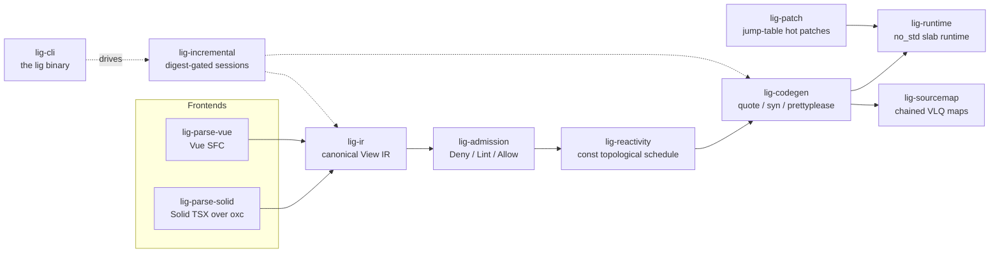

<div align="center">
  
  <p>
    <strong>A Rust UI compiler that turns Solid TSX and Vue SFCs into no_std native components</strong><br/>
    Both frontends — Solid TSX (the dom-expressions passes ported to Rust over the oxc parser)
    and Vue SFC (<code>&lt;script setup&gt;</code> + <code>&lt;template&gt;</code>) — lower into one
    canonical View IR, so the same component spelled twice compiles to byte-identical IR.
    A Deny/Lint/Allow admission ladder, a const topological schedule, and a
    <code>quote!</code> → <code>syn</code> → <code>prettyplease</code> pipeline emit readable Rust
    that runs on a <code>#![no_std]</code> slab runtime behind an object-safe <code>Host</code> trait.
    For teams that want a reactive UI layer with a known, enforced subset — embedded to web hosts —
    CI byte-compares both frontend legs of 27 conformance fixtures against the committed contract on every push.
  </p>
  <p>
    <a href="https://github.com/elcoosp/ligature/actions/workflows/ci.yml"></a>
    <a href="docs/adr/0012-msrv-and-dependency-pins.md"></a>
    <a href="LICENSE-MIT"></a>
    <a href="CHANGELOG.md"></a>
    <a href="fixtures/README.md"></a>
  </p>
</div>

<p align="center">
  <a href="#quickstart">Quickstart</a> • <a href="#features">Features</a> • <a href="#how-it-works">How it works</a> • <a href="#usage">Usage</a> • <a href="#status">Status</a> • <a href="#learn-more">Learn more</a>
</p>

## Quickstart

Prerequisites: Rust via rustup — `rust-toolchain.toml` pins 1.99.1 (MSRV 1.97); no other tooling required.

```sh
git clone https://github.com/elcoosp/ligature && cd ligature

# Print the canonical View IR for a fixture component
cargo run -p lig-cli -- inspect fixtures/conformance/counter/input.vue

# Admit-check both spellings of the same counter (Solid TSX and Vue SFC)
cargo run -p lig-cli -- check fixtures/conformance/counter/input.solid.tsx \
                          fixtures/conformance/counter/input.vue

# Emit Rust, IR, source maps, and a manifest — fail-closed: a denial writes nothing
cargo run -p lig-cli -- build fixtures/conformance/counter/input.solid.tsx --out dist
```

A successful build leaves this artifact set (verified by the CLI's own integration tests):

```text
dist/
├── counter.rs              # generated component (byte-reproducible)
├── ir/counter.json         # canonical View IR JSON
├── maps/counter.map.json   # chained VLQ source map, IR node names in names[]
├── manifest.toml           # the unit manifest
└── build-state.json        # per-unit digests powering incremental re-emission
```

`check` prints an admitted/denied summary per file and exits 1 on any Deny-tier diagnostic;
`build` refuses to touch `dist/` unless every unit is admitted.

> [!TIP]
> Run `cargo run -p lig-cli -- doctor` first: it reports the embedded error catalog,
> the budget ledger, patch-protocol availability on your platform, and which no_std
> proof targets are installed.

## Features

- **Two frontends, one contract.** Solid TSX and Vue SFC lower into the same canonical View IR; `lig fixtures verify` byte-compares both legs of 27 conformance fixtures in CI, and a fixture without both legs fails the gate.
- **Fail-closed admission ladder.** Every construct lands in exactly one Deny/Lint/Allow tier — 11 rules in `docs/admission/rules.md`, each backed by an allow fixture and a deny/lint fixture, synced 1:1 by a CI gate. A Deny means zero output downstream.
- **Byte-reproducible codegen.** `quote!` → `syn::File` → `prettyplease` emits Rust that is byte-identical across runs: `lig reproducibility` diffs the committed counter unit (7,437 B, component digest `0x85d06a5c087b3589`) against a fresh generation, and a readability budget is enforced by a syn visitor.
- **no_std runtime with keyed reconciliation.** The runtime is `#![no_std]` + alloc with `forbid(unsafe_code)`: `Copy` node handles, an object-safe `Host` commit stream, LIS-stable keyed list diffs, and a const-scheduled flush loop. CI proves bare-metal builds for `thumbv7em-none-eabihf` and `aarch64-unknown-none-softfloat`.
- **Incremental by construction.** FNV-1a digest-gated memos skip unchanged work in `lig build` and `lig watch`; build-order cycles surface as `LIG-E020` denials instead of hangs; chained source maps attribute every generated position back to source, per reaction arm.
- **Composed slot content.** Fills and fallbacks are full component surfaces: dynamic binds, events, refs, If/For (M8), grandchild component uses with reactive prop-pass, and nested outlets whose fills and fallbacks mount with their content (M9) — all addressed by one composed `Ctx` walk, with an exact mount-time story per shape.
- **A hot-patch protocol with a budget.** One patch dylib, an atomically swapped jump table, never-`dlclose` semantics; `lig patch-spike` chains two patch generations with stub thunks and enforces save→frame under 1 second on Linux and macOS (measured ~125–140 ms).
- **Performance budgets as a gate, not a vibe.** `docs/benchmarks/budgets.toml` pins one ceiling per bench workload — at least 5x headroom over the recorded reference median — enforced in release mode by `lig budgets` in CI.

## How it works

Each frontend lowers its input into the same canonical View IR; from there the pipeline is
admission, scheduling, codegen, and emission, all wrapped in a digest-gated session engine
so repeated builds and watch passes reuse unchanged work.



Supporting crates round out the pipeline: `lig-expr` lowers the oxc AST into the expression
forest and decides what counts as dynamic, `lig-style` and `lig-taffy-profile` normalize
style into const-fn layout tables, and `lig-core` supplies spans, u32 ids, interning, and the
error-code registry. Hosts implement the `Host` commit stream — the repo ships a `mock-host`
adapter plus `tests/dummy-host` and `tests/compile-clean` harnesses, and the single `unsafe`
module in the workspace is `lig-patch`, isolated by policy.

## Usage

The `lig` binary (crate `lig-cli`) is the primary interface. Common commands:

| Command | Purpose |
| --- | --- |
| `lig check <paths>` | Admission over `.tsx`/`.vue` sources, no codegen; `--deny-warn` promotes lints to denials |
| `lig build <paths>` | Emit Rust + IR + source maps + manifest to `--out dist` (fail-closed, digest-gated) |
| `lig watch <paths>` | Rebuild on save (`--once` for a single pass); a denied pass never touches `dist/` |
| `lig inspect <file>` | Print the canonical View IR JSON for one source file |
| `lig explain <code>` | Long-form help for a diagnostic code, served from the embedded catalog |
| `lig resolve <map> <line> <col>` | Map a generated-Rust position back to source through a `.map.json` |
| `lig doctor` | Environment checks: catalog, budget ledger, patch protocol, no_std targets |
| `lig fixtures verify` | The CI parity gate over `fixtures/conformance/**` (both frontend legs) |
| `lig reproducibility` | Byte-diff committed codegen against a fresh generation |
| `lig budgets`, `lig no-std`, `lig patch-spike`, `lig incremental` | The remaining CI gates, runnable locally |

The same flow works from Rust through the incremental session API (this is what the CLI itself uses):

```rust
use lig_admission::Profile;
use lig_incremental::Session;

let mut session = Session::new();
session.set_source(&path, source_text);
let report = session.compile(Profile::Layout);

let unit = session.unit(&path).expect("registered source");
assert!(unit.admitted, "denied: {:?}", unit.diagnostics);
```

Generated units are plain Rust built on `lig_runtime`'s prelude — see the committed example
at `fixtures/generated/counter.rs`, walked line by line in `docs/appendix-a.md`. The full
generated shape: a component struct with state fields, generated setters as the only write
path, a const `Schedule`, static template tables, and `build`/`fire_*` entry points.

## Status

> [!NOTE]
> Pre-1.0 research toolchain at version 0.1.0 — milestone M9 complete, with the View IR
> schema at v5 and the compiled subset deliberately small: constructs outside the contract
> (component uses inside branch/list bodies of slot content, events in `For` bodies,
> callback calls, raw DOM access) deny with a precise code rather than mis-compile. CI runs on Linux and macOS;
> the patch protocol is unix-only `dlopen` (`lig doctor` reports it unavailable on Windows).
> MSRV is 1.97, edition 2024, toolchain pinned at 1.99.1. The release workflow publishes
> changelogs, not crates — build from source.

## Learn more

- Milestone reports: [`docs/m0/REPORT.md`](docs/m0/REPORT.md) through [`docs/m9/REPORT.md`](docs/m9/REPORT.md) — what each milestone delivered and measured
- [`docs/appendix-a.md`](docs/appendix-a.md) — the annotated generated unit every gate pins
- Architecture decisions in [`docs/adr/`](docs/adr/): MSRV and dependency pins (0012), the Vue frontend (0014), incremental sessions (0015), the ThinLink patch engine (0016), budgets and no_std (0017), dynamic slot content (0020), structural slot content (0021), component-in-content and nested outlets (0022)
- [`docs/admission/rules.md`](docs/admission/rules.md) — the Deny/Lint/Allow rule table; the 15-doc diagnostic catalog under [`docs/errors/`](docs/errors/)
- Benchmarks: [`docs/benchmarks/budgets.toml`](docs/benchmarks/budgets.toml) (enforced ceilings), [`docs/benchmarks/save-to-frame.md`](docs/benchmarks/save-to-frame.md) (patch protocol numbers), [`docs/benchmarks/oxc-vs-swc.md`](docs/benchmarks/oxc-vs-swc.md) (the parser re-benchmark)
- [`fixtures/README.md`](fixtures/README.md) — the conformance contract both frontends must satisfy
- [`CHANGELOG.md`](CHANGELOG.md) — git-cliff-generated release notes
