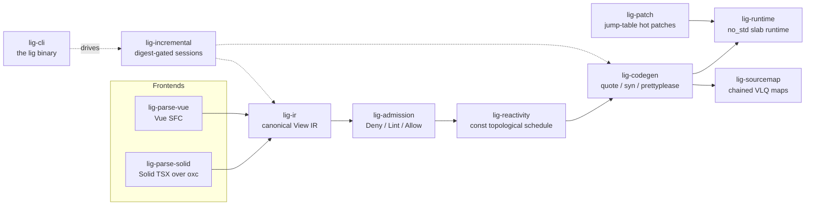

<div align="center">
  
  <p>
    <strong>A Rust UI compiler that turns Solid TSX and Vue SFCs into no_std native components</strong><br/>
    Both frontends — Solid TSX (the dom-expressions passes ported to Rust over the oxc parser)
    and Vue SFC (<code>&lt;script setup&gt;</code> + <code>&lt;template&gt;</code>) — lower into one
    canonical View IR, so the same component spelled twice compiles to byte-identical IR.
    A Deny/Lint/Allow admission ladder, a const topological schedule, and a
    <code>quote!</code> → <code>syn</code> → <code>prettyplease</code> pipeline emit readable Rust
    that runs on a <code>#![no_std]</code> slab runtime behind an object-safe <code>Host</code> trait.
    For teams that want a reactive UI layer with a known, enforced subset — embedded to web hosts —
    CI byte-compares both frontend legs of 36 conformance fixtures against the committed contract on every push.
  </p>
  <p>
    <a href="https://github.com/elcoosp/ligature/actions/workflows/ci.yml"></a>
    <a href="docs/adr/0012-msrv-and-dependency-pins.md"></a>
    <a href="LICENSE-MIT"></a>
    <a href="CHANGELOG.md"></a>
    <a href="fixtures/README.md"></a>
  </p>
</div>

<p align="center">
  <a href="#quickstart">Quickstart</a> • <a href="#features">Features</a> • <a href="#how-it-works">How it works</a> • <a href="#usage">Usage</a> • <a href="#status">Status</a> • <a href="#learn-more">Learn more</a>
</p>

## Quickstart

Prerequisites: Rust via rustup — `rust-toolchain.toml` pins 1.99.1 (MSRV 1.97); no other tooling required.

```sh
git clone https://github.com/elcoosp/ligature && cd ligature

# Print the canonical View IR for a fixture component
cargo run -p lig-cli -- inspect fixtures/conformance/counter/input.vue

# Admit-check both spellings of the same counter (Solid TSX and Vue SFC)
cargo run -p lig-cli -- check fixtures/conformance/counter/input.solid.tsx \
                          fixtures/conformance/counter/input.vue

# Emit Rust, IR, source maps, and a manifest — fail-closed: a denial writes nothing
cargo run -p lig-cli -- build fixtures/conformance/counter/input.solid.tsx --out dist
```

A successful build leaves this artifact set (verified by the CLI's own integration tests):

```text
dist/
├── counter.rs              # generated component (byte-reproducible)
├── ir/counter.json         # canonical View IR JSON
├── maps/counter.map.json   # chained VLQ source map, IR node names in names[]
├── manifest.toml           # the unit manifest
└── build-state.json        # per-unit digests powering incremental re-emission
```

`check` prints an admitted/denied summary per file and exits 1 on any Deny-tier diagnostic;
`build` refuses to touch `dist/` unless every unit is admitted.

> [!TIP]
> Run `cargo run -p lig-cli -- doctor` first: it reports the embedded error catalog,
> the budget ledger, patch-protocol availability on your platform, and which no_std
> proof targets are installed.

## Features

- **Two frontends, one contract.** Solid TSX and Vue SFC lower into the same canonical View IR; `lig fixtures verify` byte-compares both legs of 36 conformance fixtures in CI, and a fixture without both legs fails the gate. Template refs are the M12 parity addition: `ref={box}` and `ref="box"` / `:ref="box"` lower to the same `Ref` capture, byte-identical across legs.
- **Fail-closed admission ladder.** Every construct lands in exactly one Deny/Lint/Allow tier — 11 rules in `docs/admission/rules.md`, each backed by an allow fixture and a deny/lint fixture, synced 1:1 by a CI gate. A Deny means zero output downstream.
- **Byte-reproducible codegen.** `quote!` → `syn::File` → `prettyplease` emits Rust that is byte-identical across runs: `lig reproducibility` diffs the committed counter unit (7,385 B, component digest `0x85d06a5c087b3589`) against a fresh generation, and a readability budget is enforced by a syn visitor.
- **no_std runtime with keyed reconciliation, and a mount seam that closes the embedding story.** The runtime is `#![no_std]` + alloc with `forbid(unsafe_code)`: `Copy` node handles, an object-safe `Host` commit stream, LIS-stable keyed list diffs, and a const-scheduled flush loop. CI proves bare-metal builds for `thumbv7em-none-eabihf` and `aarch64-unknown-none-softfloat`. Since M20 the generated unit's lifecycle is one consumer impl (`ComponentUnit`: the `Reactions` supertrait plus the root-fragment accessor) and one handle (`Mounted`: `mount`, the `update` save-tick, the bare `flush`, and `dispose` — the total recursive LIFO teardown the host sees as one `destroy` per node the build created); since M21 the ticks are checked — `flush_checked` reports the LIG-E401 fail-safe as a typed `CycleError` carrying the pass cap instead of panicking, so a `panic = "abort"` embedded host gets the failure as data and the mount front fails like the compiler does.
- **Incremental by construction.** FNV-1a digest-gated memos skip unchanged work in `lig build` and `lig watch`; build-order cycles surface as `LIG-E020` denials instead of hangs; chained source maps attribute every generated position back to source, per reaction arm. Since M16 the session stages walk named `tracing` spans (`session_compile`/`lower`/`admit`/`codegen`/`emit`) and `emit_units` fails as a typed miette `Diagnostic` (`ligature::emit`) with help-text; since M18 the session's codegen seam fails the same way (`CodegenFailure`, code `ligature::codegen`, help-text naming the fix, a `tracing::warn!` on the failure path) and `lower_source` denies unsupported extensions with one precise reason — the embed API is observable and fails like the CLI does. The emission target is a seam too: `emit_units_to` writes the digest-gated artifact set into any `ArtifactSink` — the atomic `FsSink` (`dist/`, what the CLI drives) or the in-memory `MemSink` (tests, embedded hosts) — byte-for-byte identical across sinks; and one `Session::sync` call diffs a fresh source snapshot into added/edited/removed (with keep-roots for explicit inputs), the exact tick `lig watch` runs. And since M19 the pass itself is observable as events — `Session::compile_with` hands every stage's outcome and own wall clock to a caller-owned `SessionObserver`, 1:1 with the tracing spans (measured ≈0.2% over the unobserved pass) — and emission is a one-call, fail-closed session seam: `Session::emit_to` writes the artifact set into any sink and refuses a denied pass (BR-1) before the sink sees a byte, with `Profile::name` carrying the load-bearing ledger spelling. And since M23 the watch loop itself is one seam call — `Session::tick` diffs the snapshot, compiles what the digest gate invalidated, and emits fail-closed into any sink (the BR-1 gate shared with `emit_to`; the observed `tick_with` rides the same stage events), with the emptied-session prune policy pinned and the CLI's `lig watch` loop body driving it.
- **Composed slot content, assembled at every mount.** Fills and fallbacks are full component surfaces: dynamic binds, events, refs, If/For (M8), grandchild component uses with reactive prop-pass, nested outlets whose fills and fallbacks mount with their content (M9), and per-mount component identity plus branch-time assembly — a component or outlet inside a branch mounts, initializes, disposes, and rebuilds with its branch (M10) — on BOTH legs of a conditional: the else leg mounts, assembles, and disposes exactly like the then leg (M11). Components compose in keyed lists too (M13): a component use in a `For`/`v-for` body owns a per-item instance store the keyed plan mirrors — inserts build + attach, removes dispose, and LIS-stable moves reposition the SAME instance. And since M14, slot outlets do the per-item story on their own: an outlet directly on a list body mounts its fallback into EVERY live item's outlet hole through the per-item replay, the mounted content moves with its item without rebuilds and disposes with it, and the fallback's item-bound binds re-apply per replay. Every component use's root attaches at its use hole exactly once per mount, in every ownership shape. And since M15, event handlers work in list bodies: a handler directly on a `For`/`v-for` body attaches once per fresh item at its own node and dispatches index-addressed through a generated per-item fire fn — the live item's value substitutes into the handler body, keyed moves carry the handler record without re-attaching, removals dispose it with the item's slab, and stale indices are no-ops. And since M17, the body doesn't have to hang at the component root: a handler directly on a COMPOSED list body — a `For` inside a branch or slot content — attaches through the composed reconcile's receiver-parameterized insert arms and dispatches through the same fire fn, while handlers deeper in the item subtree (branches in items, nested lists) still deny with the precise code. And since M18 the documented composed contract is complete on the CONTENT leg: a handler AND a slot outlet directly on a composed list body inside a fill or fallback admit — the fill mounts into the fresh instance at branch mount (the per-mount fill assembly, the M18 fixture's catch: the pre-M18 build body emitted an unguarded mount on the `None` instance), the handler attaches per fresh item through the composed reconcile, the outlet's fallback mounts per item through the shared replay, and shapes deeper than the body keep their precise denials.
- **A hot-patch protocol with a budget.** One patch dylib, an atomically swapped jump table, never-`dlclose` semantics; `lig patch-spike` chains two patch generations with stub thunks and enforces save→frame under 1 second on Linux and macOS (measured ~125–140 ms).
- **Performance budgets as a gate, not a vibe.** `docs/benchmarks/budgets.toml` pins one ceiling per bench workload — at least 5x headroom over the recorded reference median — enforced in release mode by `lig budgets` in CI.

## How it works

Each frontend lowers its input into the same canonical View IR; from there the pipeline is
admission, scheduling, codegen, and emission, all wrapped in a digest-gated session engine
so repeated builds and watch passes reuse unchanged work.



Supporting crates round out the pipeline: `lig-expr` lowers the oxc AST into the expression
forest and decides what counts as dynamic, `lig-style` and `lig-taffy-profile` normalize
style into const-fn layout tables, and `lig-core` supplies spans, u32 ids, interning, and the
error-code registry. Hosts implement the `Host` commit stream — the repo ships a `mock-host`
adapter plus `tests/dummy-host` and `tests/compile-clean` harnesses, and the single `unsafe`
module in the workspace is `lig-patch`, isolated by policy.

## Usage

The `lig` binary (crate `lig-cli`) is the primary interface. Common commands:

| Command | Purpose |
| --- | --- |
| `lig check <paths>` | Admission over `.tsx`/`.vue` sources, no codegen; `--deny-warn` promotes lints to denials |
| `lig build <paths>` | Emit Rust + IR + source maps + manifest to `--out dist` (fail-closed, digest-gated) |
| `lig watch <paths>` | Rebuild on save (`--once` for a single pass); a denied pass never touches `dist/` |
| `lig inspect <file>` | Print the canonical View IR JSON for one source file |
| `lig explain <code>` | Long-form help for a diagnostic code, served from the embedded catalog |
| `lig resolve <map> <line> <col>` | Map a generated-Rust position back to source through a `.map.json` |
| `lig doctor` | Environment checks: catalog, budget ledger, patch protocol, no_std targets |
| `lig fixtures verify` | The CI parity gate over `fixtures/conformance/**` (both frontend legs) |
| `lig reproducibility` | Byte-diff committed codegen against a fresh generation |
| `lig budgets`, `lig no-std`, `lig patch-spike`, `lig incremental` | The remaining CI gates, runnable locally |

The same flow works from Rust through the incremental session API (this is what the CLI itself uses):

```rust
use lig_admission::Profile;
use lig_incremental::Session;

let mut session = Session::new();
session.set_source(&path, source_text);
let report = session.compile(Profile::Layout);

let unit = session.unit(&path).expect("registered source");
assert!(unit.admitted, "denied: {:?}", unit.diagnostics);
```

Runnable consumer examples live in `crates/lig-incremental/examples` — run them without touching `dist/`:

```sh
cargo run -p lig-incremental --example compile_and_emit   # cold pass → memo reuse → digest-gated emit → the generated unit
cargo run -p lig-incremental --example render_denial      # a LIG-E114 denial, rendered with its fix and catalog URL
cargo run -p lig-incremental --example composed_events    # M17: a handler on a list body inside a branch — and the zone that still denies
cargo run -p lig-incremental --example composed_content   # M18: a handler + an outlet on a composed CONTENT list body — and the zone that still denies
cargo run -p lig-incremental --example mem_sink           # the ArtifactSink seam: the full artifact set emitted into memory, no dist/
cargo run -p lig-incremental --example watch_sync         # the Session::sync seam: a watch tick as one call — added/edited/removed
cargo run -p lig-incremental --example observed_pass      # M19: the session-observer seam — per-stage outcomes and wall clocks as events
cargo run -p lig-incremental --example custom_sink        # M19: a consumer-implemented content-addressed ArtifactSink + the fail-closed session emit
cargo run -p lig-incremental --example watch_tick         # M23: the watch-tick seam — sync → compile → fail-closed emission as ONE call, refusals included
```

The source-map half has its own walkthrough (M22) — the recorded link table,
the chained maps, position resolution, and the typed failure, all in the
library (no `dist/`, no scanning):

```sh
cargo run -p lig-sourcemap --example link_table
cargo run -p lig-sourcemap --example resolve_position    # M24: generated positions resolved back to source through the library resolver
```

The runtime half has its own walkthrough — the committed counter unit mounted,
driven, and disposed on the mock host through the component-mount seam (M20),
with the checked-tick cycle error (M21) as the failure path:

```sh
cargo run -p compile-clean --example host_mount           # M20/M21: mount → save-tick → event dispatch → dispose — and the typed LIG-E401 tick
```

Generated units are plain Rust built on `lig_runtime`'s prelude — see the committed example
at `fixtures/generated/counter.rs`, walked line by line in `docs/appendix-a.md`. The full
generated shape: a component struct with state fields, generated setters as the only write
path, a const `Schedule`, static template tables, and `build`/`fire_*` entry points.

## Status

> [!NOTE]
> Research toolchain at 1.4.0 — milestones M12 (template refs on the
> Vue leg), M13 (per-item instance identity: a component use inside a
> keyed list body builds one instance per live item — the keyed plan
> builds, attaches, disposes, and repositions it), M14 (per-item
> slot assembly: a slot outlet directly on a list body mounts its
> fallback into every live item's outlet hole through the per-item
> replay — the mounted content moves with its item and disposes with
> it), M15 (per-item event dispatch: a handler directly on a
> list body attaches per fresh item and dispatches index-addressed
> through a generated per-item fire fn — the live item substitutes
> into the handler body), M16 (the consumer surface: the first
> runnable `examples/`, `tracing` spans across the session stages, a
> typed `EmitError` with miette help-text on the emission seam),
> M17 (composed-list events: a handler directly on a branch- or
> slot-owned list body attaches through the composed reconcile's
> receiver-parameterized insert arms and dispatches through the same
> per-item fire fn; list-carrying branches remount through the mount
> mark), M18 (the composed-content owner-direct lift: a handler AND
> a slot outlet directly on a composed CONTENT list body admit — the
> per-mount fill assembly completes the branch-mounted instance story,
> and the session's codegen seam fails as a typed miette
> `CodegenFailure`), and M19 (the session seams: a caller-owned stage
> observer over the compile pipeline — per-stage outcomes and own wall
> clocks as events, 1:1 with the tracing spans — and the one-call
> fail-closed session emission into any `ArtifactSink`, the profile
> ledger name living in the library) complete — and the runtime half now
> closes the same way: M20 (the component-mount seam: one consumer impl
> (`ComponentUnit`) plus the `Mounted` lifecycle front — mount, save-tick
> via `update`, bare tick via `flush`, and the total recursive LIFO
> `dispose`, walked end to end by the `host_mount` example on the
> committed counter unit), and M21 (the checked flush seam:
> `flush_checked` reports the LIG-E401 fail-safe as a typed `CycleError`
> carrying the pass cap instead of panicking — the `no_std`
> `panic = "abort"` surface gets the failure as data, and the mount front
> fails like the compiler does) — and the map half closes the same way:
> M22 (the recorded link table: the emitter records the §9.4
> `IrLink { ir_ordinal, generated_offset }` table post-unparse and fails
> on its own missing markers (`CodegenError::LinkTable`), the consumer
> builds the `IR→Rust` map from recorded offsets with no text scanning,
> a drifted offset fails as the typed `SourceMapError` (`ligature::sourcemap`)
> at both `ir_to_rust` and `verify` — the `IrRustLink` shape is populated
> at last, and the chained-map story has its first consumer walkthrough
> example), M23 (the watch-tick seam: `Session::tick` composes the watch
> loop's snapshot diff, digest-gated compile, and fail-closed emission as
> one call — the BR-1 gate shared with `emit_to`, the observer seat riding
> `tick_with`, the emptied-session prune policy pinned, and the `lig watch`
> loop body driving the seam), and M24 (the library position resolver:
> `lig_sourcemap::resolve` turns a generated 0-based position into the
> typed `ResolvedPosition` — source, line, col, IR label — with the miss
> as `SourceMapError::Unmapped`; the CLI's `lig resolve` delegates to it,
> and the chained-map story closes end to end in the library), with the View IR
> schema at v5 and the compiled subset deliberately small: constructs outside the contract
> (events inside list-item branches and nested list bodies, callback calls, raw DOM access) deny with a precise code rather than mis-compile. CI runs on Linux and macOS;
> the patch protocol is unix-only `dlopen` (`lig doctor` reports it unavailable on Windows).
> MSRV is 1.97, edition 2024, toolchain pinned at 1.99.1. The release workflow publishes
> changelogs, not crates — build from source.

## Learn more

- Milestone reports: [`docs/m0/REPORT.md`](docs/m0/REPORT.md) through [`docs/m24/REPORT.md`](docs/m24/REPORT.md) — what each milestone delivered and measured (M23, the watch-tick seam, and M24, the library position resolver, are delivered on this tree at [`docs/m23/REPORT.md`](docs/m23/REPORT.md) and [`docs/m24/REPORT.md`](docs/m24/REPORT.md))
- [`docs/appendix-a.md`](docs/appendix-a.md) — the annotated generated unit every gate pins
- Architecture decisions in [`docs/adr/`](docs/adr/): MSRV and dependency pins (0012), the Vue frontend (0014), incremental sessions (0015), the ThinLink patch engine (0016), budgets and no_std (0017), dynamic slot content (0020), structural slot content (0021), component-in-content and nested outlets (0022), per-mount identity and the branch-time assembly (0023), the else leg (0024), template refs on the Vue leg (0025), per-item instance identity (0026), per-item slot assembly (0027), per-item event dispatch (0028), the consumer surface (0029), composed-list events (0030), the composed-content owner-direct lift (0031), the session-observer and session-emission seams (0032), the component-mount seam (0033), the checked flush seam (0034), the recorded link table (0035), the watch-tick seam (0036), the library position resolver (0037)
- [`docs/admission/rules.md`](docs/admission/rules.md) — the Deny/Lint/Allow rule table; the 15-doc diagnostic catalog under [`docs/errors/`](docs/errors/)
- Benchmarks: [`docs/benchmarks/budgets.toml`](docs/benchmarks/budgets.toml) (enforced ceilings), [`docs/benchmarks/save-to-frame.md`](docs/benchmarks/save-to-frame.md) (patch protocol numbers), [`docs/benchmarks/oxc-vs-swc.md`](docs/benchmarks/oxc-vs-swc.md) (the parser re-benchmark)
- [`fixtures/README.md`](fixtures/README.md) — the conformance contract both frontends must satisfy
- [`CHANGELOG.md`](CHANGELOG.md) — git-cliff-generated release notes
