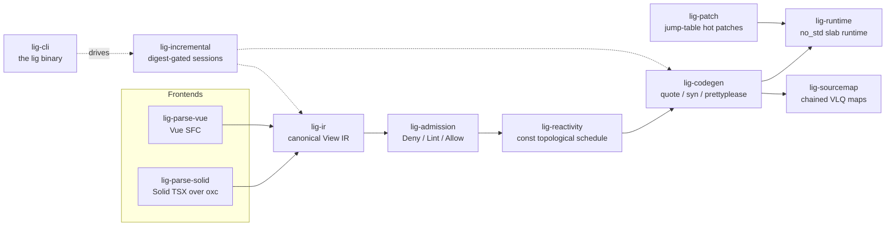

<div align="center">
  
  <p>
    <strong>A Rust UI compiler that turns Solid TSX and Vue SFCs into no_std native components.</strong><br/>
    Two frontends — Solid TSX (the dom-expressions passes ported to Rust over oxc) and Vue SFC
    (<code>&lt;script setup&gt;</code> + <code>&lt;template&gt;</code>) — lower into one canonical
    View IR: the same component spelled twice compiles to <em>byte-identical</em> IR. A
    Deny/Lint/Allow admission ladder, a const topological schedule, and a
    <code>quote!</code> → <code>syn</code> → <code>prettyplease</code> pipeline emit readable Rust
    for a <code>#![no_std]</code> slab runtime behind an object-safe <code>Host</code> trait.
    For teams that want a reactive UI layer with a known, enforced subset — embedded to web hosts.
  </p>
  <p>
    <a href="https://github.com/elcoosp/ligature/actions/workflows/ci.yml"></a>
    <a href="docs/adr/0012-msrv-and-dependency-pins.md"></a>
    <a href="LICENSE-MIT"></a>
    <a href="CHANGELOG.md"></a>
    <a href="fixtures/README.md"></a>
  </p>
</div>

<p align="center">
  <a href="#highlights">Highlights</a> • <a href="#quickstart">Quickstart</a> • <a href="#how-it-works">How it works</a> • <a href="#what-composes">Composition</a> • <a href="#the-no_std-runtime">Runtime</a> • <a href="#embedding-the-session-api">Session API</a> • <a href="#status--milestones">Status</a> • <a href="#learn-more">Learn more</a>
</p>

---

## Highlights

|                                    |                                                                                                                                                                                                      |
| ---------------------------------- | ---------------------------------------------------------------------------------------------------------------------------------------------------------------------------------------------------- |
| 🧬 **Two frontends, one contract** | The same component in Solid TSX and Vue SFC lowers to byte-identical View IR — 36 fixtures × 2 legs, byte-compared against the committed contract on every push.                                     |
| 🚧 **Fail-closed admission**       | Every construct lands in exactly one Deny/Lint/Allow tier — 11 rules, each backed by an allow fixture _and_ a deny/lint fixture, synced 1:1 by CI. A Deny means zero output downstream.              |
| 📦 **Byte-reproducible codegen**   | `quote!` → `syn::File` → `prettyplease`; the committed counter unit (7,385 B, digest `0x85d06a5c087b3589`) is byte-diffed against fresh generation, and a syn visitor enforces a readability budget. |
| 🔩 **no_std runtime**              | `#![no_std]` + alloc, `forbid(unsafe_code)`, `Copy` node handles, LIS-stable keyed diffs, a const-scheduled flush — proven on bare-metal targets in CI.                                              |
| ♻️ **Incremental by construction** | FNV-1a digest-gated memos; snapshot diff, compile, emit and the whole watch tick as one-call session seams — the CLI drives the same API embedders get.                                              |
| 🔥 **Hot patches with a budget**   | One patch dylib, an atomically swapped jump table, never-`dlclose`; save→frame under 1 s enforced (measured ~125–140 ms on Linux and macOS).                                                         |
| 📏 **Budgets as gates, not vibes** | One ceiling per bench workload — ≥ 5× headroom over the recorded reference median — enforced in release mode by CI.                                                                                  |

**Every claim is a gate, runnable locally:**

| Gate            | What it proves                                                                          | Command               |
| --------------- | --------------------------------------------------------------------------------------- | --------------------- |
| Frontend parity | Both legs of all 36 fixtures byte-match the committed IR; a fixture missing a leg fails | `lig fixtures verify` |
| Reproducibility | Committed codegen byte-diffed against a fresh generation + the readability budget       | `lig reproducibility` |
| Budgets         | Every bench workload under its pinned ceiling (`docs/benchmarks/budgets.toml`)          | `lig budgets`         |
| no_std          | Bare-metal builds: `thumbv7em-none-eabihf`, `aarch64-unknown-none-softfloat`            | `lig no-std`          |
| Patch protocol  | Two patch generations chained through stub thunks, save→frame < 1 s                     | `lig patch-spike`     |
| Incremental     | Digest-gated reuse contracts                                                            | `lig incremental`     |

> [!IMPORTANT]
> **Fail-closed, end to end.** Constructs outside the contract deny with a precise code rather
> than mis-compile. `build` refuses to touch `dist/` unless every unit is admitted, and the
> session's emission seams share that gate (BR-1) — a denied pass never reaches a sink. The
> runtime fails the same way: `flush_checked` reports a cycle as a typed `CycleError`
> (LIG-E401, carrying the pass cap), so a `panic = "abort"` embedded host gets the failure as
> data, not a panic.

## Quickstart

Rust via rustup — `rust-toolchain.toml` pins 1.99.1 (MSRV 1.97); no other tooling required.

```sh
git clone https://github.com/elcoosp/ligature && cd ligature

# Print the canonical View IR for a fixture component
cargo run -p lig-cli -- inspect fixtures/conformance/counter/input.vue

# Admit-check both spellings of the same counter (Solid TSX and Vue SFC)
cargo run -p lig-cli -- check fixtures/conformance/counter/input.solid.tsx \
                          fixtures/conformance/counter/input.vue

# Emit Rust, IR, source maps, and a manifest — fail-closed: a denial writes nothing
cargo run -p lig-cli -- build fixtures/conformance/counter/input.solid.tsx --out dist
```

A successful build leaves this artifact set (verified by the CLI's own integration tests):

```text
dist/
├── counter.rs              # generated component (byte-reproducible)
├── ir/counter.json         # canonical View IR JSON
├── maps/counter.map.json   # chained VLQ source map, IR node names in names[]
├── manifest.toml           # the unit manifest
└── build-state.json        # per-unit digests powering incremental re-emission
```

> [!TIP]
> Run `cargo run -p lig-cli -- doctor` first: it reports the embedded error catalog, the budget
> ledger, patch-protocol availability on your platform, and which no_std proof targets are
> installed.

**The full `lig` surface:**

| Command                                                                                                              | Purpose                                                                                                |
| -------------------------------------------------------------------------------------------------------------------- | ------------------------------------------------------------------------------------------------------ |
| `lig check <paths>`                                                                                                  | Admission over `.tsx`/`.vue`, no codegen; `--deny-warn` promotes lints to denials; exits 1 on any Deny |
| `lig build <paths>`                                                                                                  | Emit Rust + IR + maps + manifest to `--out dist` (fail-closed, digest-gated)                           |
| `lig watch <paths>`                                                                                                  | Rebuild on save (`--once` for a single pass); a denied pass never touches `dist/`                      |
| `lig inspect <file>`                                                                                                 | Print the canonical View IR JSON                                                                       |
| `lig explain <code>`                                                                                                 | Long-form help for a diagnostic, from the embedded catalog                                             |
| `lig resolve <map> <line> <col>`                                                                                     | Map a generated-Rust position back to source                                                           |
| `lig doctor`                                                                                                         | Environment checks: catalog, budgets, patch protocol, no_std targets                                   |
| `lig fixtures verify` · `lig reproducibility` · `lig budgets` · `lig no-std` · `lig patch-spike` · `lig incremental` | The CI gates above, runnable locally                                                                   |

## How it works

Each frontend lowers into the same canonical View IR; from there the pipeline is admission,
scheduling, codegen and emission — wrapped in a digest-gated session engine so repeated builds
and watch passes reuse unchanged work.



**The admission ladder** — every construct lands in exactly one tier
([rules](docs/admission/rules.md), each with an allow fixture and a deny/lint fixture):

| Tier      | Meaning                                                               |
| --------- | --------------------------------------------------------------------- |
| **Deny**  | Zero output downstream; `check` exits 1, `build`/`emit` write nothing |
| **Lint**  | Admitted with a diagnostic; `--deny-warn` promotes to Deny            |
| **Allow** | In the contract, compiled                                             |

| Crate                               | Role                                                                                    |
| ----------------------------------- | --------------------------------------------------------------------------------------- |
| `lig-parse-solid` / `lig-parse-vue` | the two frontends: dom-expressions over oxc · `<script setup>` + `<template>`           |
| `lig-expr`                          | oxc AST → expression forest; decides what counts as dynamic                             |
| `lig-ir`                            | the canonical View IR (schema v5)                                                       |
| `lig-admission`                     | the Deny/Lint/Allow ladder and profiles                                                 |
| `lig-reactivity`                    | the const topological schedule                                                          |
| `lig-codegen`                       | `quote!` → `syn` → `prettyplease`; records the link table post-unparse                  |
| `lig-sourcemap`                     | chained VLQ maps + the library position resolver                                        |
| `lig-runtime`                       | the `#![no_std]` slab runtime, `Host` trait, mount seam                                 |
| `lig-incremental`                   | digest-gated sessions, sinks, observer, the watch tick                                  |
| `lig-patch`                         | jump-table hot patches — **the workspace's single `unsafe` module, isolated by policy** |
| `lig-style` / `lig-taffy-profile`   | style normalized into const-fn layout tables                                            |
| `lig-core`                          | spans, u32 ids, interning, the error-code registry                                      |
| `lig-cli`                           | the `lig` binary                                                                        |

Hosts implement the object-safe `Host` commit stream — the repo ships a `mock-host` adapter
plus `tests/dummy-host` and `tests/compile-clean` harnesses.

## What composes

Slot fills and fallbacks are full component surfaces, and the ownership story is complete at
every mount — each row is fixture-pinned on **both** frontend legs:

| Capability                    | What ships                                                                                                                                                                                                                  | Since |
| ----------------------------- | --------------------------------------------------------------------------------------------------------------------------------------------------------------------------------------------------------------------------- | ----- |
| **Dynamic content**           | Fills and fallbacks carry dynamic binds, events, refs, If/For                                                                                                                                                               | M8    |
| **Structural content**        | Grandchild component uses with reactive prop-pass; nested outlets whose fills and fallbacks mount with their content                                                                                                        | M9    |
| **Branch-time assembly**      | Per-mount component identity: a component or outlet inside a branch mounts, initializes, disposes and rebuilds _with its branch_                                                                                            | M10   |
| **Both legs**                 | The else leg mounts, assembles and disposes exactly like the then leg                                                                                                                                                       | M11   |
| **Template refs**             | `ref={box}` ≡ `ref="box"` / `:ref="box"` → the same `Ref` capture, byte-identical across legs                                                                                                                               | M12   |
| **Components in keyed lists** | A component use in a `For`/`v-for` body owns a per-item instance store: inserts build + attach, removes dispose, LIS-stable moves reposition the **same** instance                                                          | M13   |
| **Per-item outlets**          | An outlet on a list body mounts its fallback into **every** live item's hole via per-item replay; content moves without rebuilds, disposes with its item, item-bound binds re-apply                                         | M14   |
| **Per-item events**           | A handler on a list body attaches once per fresh item, dispatches index-addressed through a generated fire fn (the live item's value substitutes in); moves carry the record, removals dispose it, stale indices are no-ops | M15   |
| **Composed-list events**      | The body can hang inside a branch or slot content: receiver-parameterized insert arms, the same fire fn; list-carrying branches remount through the mount mark                                                              | M17   |
| **Composed content**          | A handler **and** an outlet directly on a composed _content_ list body admit — the fill mounts into the fresh instance at branch mount (per-mount fill assembly)                                                            | M18   |

Every component use's root attaches at its use hole exactly once per mount, in every ownership
shape. **The boundary stays honest**: handlers deeper in the item subtree — branches in items,
nested lists — still deny with the precise code.

## The no_std runtime

`#![no_std]` + alloc, `forbid(unsafe_code)`: `Copy` node handles, an object-safe `Host` commit
stream, LIS-stable keyed list diffs, a const-scheduled flush loop. CI proves bare-metal builds
for `thumbv7em-none-eabihf` and `aarch64-unknown-none-softfloat`.

**The mount seam (M20/M21)** — one consumer impl, one handle:

| Piece                    | Contract                                                                                                               |
| ------------------------ | ---------------------------------------------------------------------------------------------------------------------- |
| `ComponentUnit`          | The `Reactions` supertrait + the root-fragment accessor — the generated unit implements it                             |
| `Mounted::mount`         | Attaches the unit at its hole                                                                                          |
| `Mounted::update`        | The save-tick                                                                                                          |
| `Mounted::flush`         | The bare tick                                                                                                          |
| `Mounted::flush_checked` | The checked tick: LIG-E401 as a typed `CycleError` carrying the pass cap — failure as data for `panic = "abort"` hosts |
| `Mounted::dispose`       | Total recursive LIFO teardown — the host sees one `destroy` per node the build created                                 |

```sh
cargo run -p compile-clean --example host_mount   # mount → save-tick → dispatch → dispose, + the typed LIG-E401 tick
```

Generated units are plain Rust on `lig_runtime`'s prelude: a component struct with state fields,
generated setters as the **only** write path, a const `Schedule`, static template tables, and
`build`/`fire_*` entry points — the committed unit lives at `fixtures/generated/counter.rs`,
walked line by line in [docs/appendix-a.md](docs/appendix-a.md).

## Embedding: the session API

The CLI drives this API; embedders get the same contracts. Every seam is observable, typed in
its failures, and fail-closed:

| Seam                          | What it does                                                                                                                                             |
| ----------------------------- | -------------------------------------------------------------------------------------------------------------------------------------------------------- |
| `Session::compile(Profile)`   | The digest-gated pass; build-order cycles surface as `LIG-E020` denials, never hangs                                                                     |
| `Session::sync`               | Diffs a fresh source snapshot into added/edited/removed, with keep-roots for explicit inputs — the exact tick `lig watch` runs                           |
| `Session::compile_with`       | Hands every stage's outcome + own wall clock to a caller-owned `SessionObserver`, 1:1 with the tracing spans (measured ≈ 0.2 % over the unobserved pass) |
| `Session::emit_to`            | One-call, fail-closed emission into any `ArtifactSink` — a denied pass (BR-1) never reaches the sink; `Profile::name` carries the ledger spelling        |
| `Session::tick` / `tick_with` | The whole watch loop as one call: snapshot diff → digest-gated compile → fail-closed emit; the emptied-session prune policy is pinned                    |
| `ArtifactSink`                | The emission target as a seam: atomic `FsSink` (`dist/`), in-memory `MemSink`, or your own — byte-for-byte identical across sinks                        |

Failures are typed miette diagnostics with help-text — `EmitError` (`ligature::emit`),
`CodegenFailure` (`ligature::codegen`), and `lower_source` denies unsupported extensions with
one precise reason. Stages walk named `tracing` spans:
`session_compile` / `lower` / `admit` / `codegen` / `emit`.

```rust
use lig_admission::Profile;
use lig_incremental::Session;

let mut session = Session::new();
session.set_source(&path, source_text);
let report = session.compile(Profile::Layout);

let unit = session.unit(&path).expect("registered source");
assert!(unit.admitted, "denied: {:?}", unit.diagnostics);
```

Runnable consumer examples (`crates/lig-incremental/examples`) — no `dist/` touched:

| Example (`cargo run -p lig-incremental --example …`) | Shows                                                                                         |
| ---------------------------------------------------- | --------------------------------------------------------------------------------------------- |
| `compile_and_emit`                                   | cold pass → memo reuse → digest-gated emit → the generated unit                               |
| `render_denial`                                      | a LIG-E114 denial rendered with its fix and catalog URL                                       |
| `composed_events`                                    | M17: a handler on a list body inside a branch — and the zone that still denies                |
| `composed_content`                                   | M18: a handler + an outlet on a composed _content_ list body — and the zone that still denies |
| `mem_sink`                                           | the full artifact set emitted into memory                                                     |
| `watch_sync`                                         | `Session::sync`: a watch tick's added/edited/removed diff                                     |
| `observed_pass`                                      | M19: per-stage outcomes and wall clocks as events                                             |
| `custom_sink`                                        | M19: a consumer-implemented content-addressed sink + fail-closed emit                         |
| `watch_tick`                                         | M23: sync → compile → fail-closed emission as **one** call, refusals included                 |

## Maps & diagnostics

- **Recorded, never scanned (M22).** The emitter records the `IrLink { ir_ordinal,
  generated_offset }` table post-unparse and fails on its own missing markers
  (`CodegenError::LinkTable`); the `IR→Rust` map is built from recorded offsets. A drifted
  offset fails as the typed `SourceMapError` (`ligature::sourcemap`) at both `ir_to_rust` and
  `verify`.
- **Chained VLQ maps** attribute every generated position back to source, per reaction arm,
  with IR node names in `names[]`.
- **The resolver is a library (M24).** `lig_sourcemap::resolve` turns a generated 0-based
  position into a typed `ResolvedPosition` — source, line, col, IR label — with the miss as
  `SourceMapError::Unmapped`. `lig resolve` delegates to it.
- **The catalog is embedded.** 15 diagnostic docs under [docs/errors/](docs/errors/);
  `lig explain <code>` serves the long-form help with the fix.

```sh
cargo run -p lig-sourcemap --example link_table        # the recorded table → chained maps → typed failure
cargo run -p lig-sourcemap --example resolve_position  # generated positions resolved back to source
```

## Hot patches & budgets

- **ThinLink patch protocol.** One patch dylib, an atomically swapped jump table,
  never-`dlclose` semantics; `lig patch-spike` chains two generations through stub thunks and
  enforces save→frame < 1 s — measured **~125–140 ms** on Linux and macOS. Unix-only `dlopen`;
  `lig doctor` reports it unavailable on Windows.
- **Budgets.** [budgets.toml](docs/benchmarks/budgets.toml) pins one ceiling per workload, each
  with ≥ 5× headroom over the recorded reference median; `lig budgets` enforces them in release
  mode in CI.

## Status & milestones

> [!NOTE]
> **Research toolchain at 1.4.0.** View IR schema **v5**; MSRV **1.97**, edition **2024**,
> toolchain pinned at **1.99.1**. CI runs on Linux and macOS. The release workflow publishes
> changelogs, not crates — build from source.

The compiled subset is **deliberately small**: constructs outside the contract — events inside
list-item branches, nested list bodies, callback calls, raw DOM access — deny with a precise
code rather than mis-compile.

| Milestone | Delivered                                                    | Report                       |
| --------- | ------------------------------------------------------------ | ---------------------------- |
| M12       | Template refs on the Vue leg                                 | [report](docs/m12/REPORT.md) |
| M13       | Per-item instance identity in keyed lists                    | [report](docs/m13/REPORT.md) |
| M14       | Per-item slot assembly through the replay                    | [report](docs/m14/REPORT.md) |
| M15       | Per-item event dispatch (index-addressed fire fns)           | [report](docs/m15/REPORT.md) |
| M16       | Consumer surface: examples, tracing spans, typed `EmitError` | [report](docs/m16/REPORT.md) |
| M17       | Composed-list events (branch/slot-owned bodies)              | [report](docs/m17/REPORT.md) |
| M18       | Composed-content owner-direct lift + typed `CodegenFailure`  | [report](docs/m18/REPORT.md) |
| M19       | Session observer + one-call fail-closed emission             | [report](docs/m19/REPORT.md) |
| M20       | The component-mount seam (`ComponentUnit` / `Mounted`)       | [report](docs/m20/REPORT.md) |
| M21       | The checked flush (`CycleError`, failure as data)            | [report](docs/m21/REPORT.md) |
| M22       | The recorded link table (no text scanning)                   | [report](docs/m22/REPORT.md) |
| M23       | The watch-tick seam (`Session::tick`)                        | [report](docs/m23/REPORT.md) |
| M24       | The library position resolver                                | [report](docs/m24/REPORT.md) |

M0–M11 (the frontends, IR, admission, codegen, runtime, slots and branch assembly) are covered
by the reports below and the [composition table](#what-composes).

## Learn more

- [Milestone reports](docs/m0/REPORT.md) — `docs/m0/` through `docs/m24/`: what each milestone delivered and measured
- [docs/appendix-a.md](docs/appendix-a.md) — the annotated generated unit every gate pins
- [Admission rules](docs/admission/rules.md) — the Deny/Lint/Allow table · the [15-doc diagnostic catalog](docs/errors/)
- [fixtures/README.md](fixtures/README.md) — the conformance contract both frontends must satisfy
- Benchmarks: [budgets.toml](docs/benchmarks/budgets.toml) · [save-to-frame.md](docs/benchmarks/save-to-frame.md) (patch numbers) · [oxc-vs-swc.md](docs/benchmarks/oxc-vs-swc.md) (the parser re-benchmark)
- [CHANGELOG.md](CHANGELOG.md) — git-cliff-generated release notes

<details><summary><b>Architecture decision records (docs/adr/)</b></summary>

**Foundations**

| ADR                                               | Decision                  |
| ------------------------------------------------- | ------------------------- |
| [0012](docs/adr/0012-msrv-and-dependency-pins.md) | MSRV and dependency pins  |
| 0014                                              | The Vue frontend          |
| 0015                                              | Incremental sessions      |
| 0016                                              | The ThinLink patch engine |
| 0017                                              | Budgets and no_std        |

**Slots & composition**

| ADR  | Decision                                    |
| ---- | ------------------------------------------- |
| 0020 | Dynamic slot content                        |
| 0021 | Structural slot content                     |
| 0022 | Component-in-content and nested outlets     |
| 0023 | Per-mount identity and branch-time assembly |
| 0024 | The else leg                                |
| 0025 | Template refs on the Vue leg                |
| 0026 | Per-item instance identity                  |
| 0027 | Per-item slot assembly                      |
| 0028 | Per-item event dispatch                     |
| 0030 | Composed-list events                        |
| 0031 | The composed-content owner-direct lift      |

**Consumer & sessions**

| ADR  | Decision                                        |
| ---- | ----------------------------------------------- |
| 0029 | The consumer surface                            |
| 0032 | The session-observer and session-emission seams |
| 0036 | The watch-tick seam                             |

**Runtime & maps**

| ADR  | Decision                      |
| ---- | ----------------------------- |
| 0033 | The component-mount seam      |
| 0034 | The checked flush seam        |
| 0035 | The recorded link table       |
| 0037 | The library position resolver |

</details>

---

<div align="center">
  <sub>Licensed under MIT OR Apache-2.0 · Two frontends, one byte-identical contract · Fail-closed, end to end · Every claim is a CI gate</sub>
</div>
